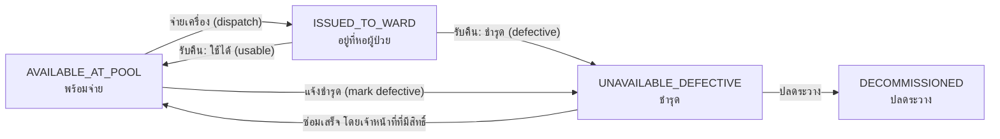
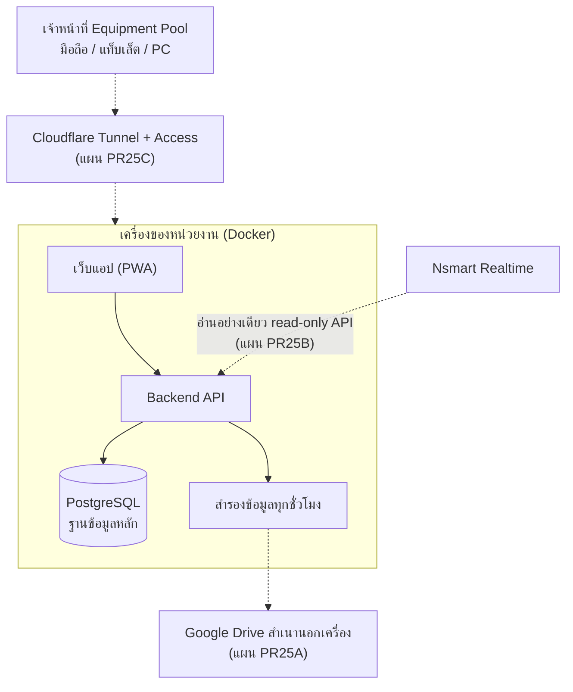

# ภาพรวมระบบ Medical Equipment Pool

**Purpose:** สรุปสำหรับหัวหน้าหน่วยงานและผู้บริหารโรงพยาบาล (ไม่เน้นเทคนิค)
**Authority:** เอกสารสรุปเท่านั้น สถานะจริงอยู่ที่ `docs/ROADMAP.md` กฎธุรกิจอยู่ที่ `docs/BUSINESS_RULES.md`
**Update trigger:** สถานะโครงการ สถาปัตยกรรม หรือขอบเขตเปลี่ยน
**Maintainer:** Repository Owner

## 1. ระบบนี้คืออะไร และทำไมต้องมี

Medical Equipment Pool คือระบบเว็บ (ใช้บนมือถือ แท็บเล็ต และคอมพิวเตอร์) สำหรับเจ้าหน้าที่
Equipment Pool ใช้บันทึกการ **จ่าย (dispatch)** เครื่องมือแพทย์จากส่วนกลางไปยังหอผู้ป่วย/หน่วยงาน
และการ **รับคืน (receipt)** ระบบนี้ **มาแทนที่กระบวนการเดิมบน AppSheet** เพื่อให้ทุกรายการมีบันทึกที่
ตรวจสอบย้อนหลังได้ ข้อมูลเดียวกันทั้งหน่วยงาน และลดการพึ่งพาสเปรดชีต

## 2. ระบบทำอะไรได้บ้าง

- บันทึกการจ่ายเครื่องมือไปยัง "หอที่รับเครื่องแรก" และบันทึกการรับคืนในขั้นตอนเดียว (ใช้ได้ / ชำรุด)
- ค้นหาและสแกนเครื่องมือด้วย QR เดิมของโรงพยาบาล (ไม่มีการเปลี่ยนระบบ QR)
- ดูสถานะเครื่องมือทุกชิ้นและประวัติการจ่าย/รับคืน
- รายงานตามวันที่และกะ (วัน/คืน) พิมพ์ได้ และส่งออกเป็น PDF และ Excel
- นำเข้าข้อมูลเดิมจาก AppSheet (ทะเบียนเครื่องมือ ประวัติรับ/จ่าย) พร้อมตรวจสอบความถูกต้อง
- บันทึกตรวจสอบ (audit log) ทุกการกระทำสำคัญ และจำกัดสิทธิ์ตามบทบาท

เฉพาะเจ้าหน้าที่ Equipment Pool เท่านั้นที่เป็นผู้ใช้ระบบ เจ้าหน้าที่หอผู้ป่วยไม่ต้องมีบัญชี

## 3. สถานะเครื่องมือ 4 แบบ

เครื่องมือแต่ละชิ้นมีสถานะเพียง 4 แบบ ไม่มีสถานะ "ทำความสะอาด" (การทำความสะอาดไม่ถูกติดตามในระบบ)

| สถานะ | ความหมาย |
|---|---|
| `AVAILABLE_AT_POOL` | อยู่ที่ Pool พร้อมจ่าย |
| `ISSUED_TO_WARD` | จ่ายไปหอผู้ป่วยแล้ว |
| `UNAVAILABLE_DEFECTIVE` | ชำรุด ใช้งานไม่ได้ |
| `DECOMMISSIONED` | ปลดระวางแล้ว (สถานะสุดท้าย ต้องผ่านสถานะชำรุดก่อนเสมอ) |

## 4. ระบบนี้ไม่ทำอะไร (โดยตั้งใจ)

- **ไม่เก็บข้อมูลผู้ป่วย** และไม่ติดตามเตียง
- **ไม่เขียนข้อมูลลงระบบ MEMS/N Smart** (แผน PR25B: ระบบอื่นจะอ่านข้อมูลจากระบบนี้ได้แบบอ่านอย่างเดียวเท่านั้น ปัจจุบันยังไม่มี API นี้)
- **ไม่ทำงานด้าน PM / สอบเทียบ (calibration) / เรียกคืน (recall)**
- ไม่ติดตามการย้ายเครื่องระหว่างหอ (บันทึกเฉพาะหอที่รับเครื่องแรก)
- ไม่ใช่ระบบทะเบียนทรัพย์สินทั้งโรงพยาบาล

## 5. สถาปัตยกรรม

ระบบรันบนคอมพิวเตอร์ของหน่วยงานที่ Owner กำหนด (Windows 11 Pro) ด้วย Docker ไม่ใช่ระบบคลาวด์ที่ต้อง
จ่ายค่าบริการ และไม่ได้อยู่ภายใต้ฝ่าย IT ของโรงพยาบาล ปัจจุบัน ข้อมูลสำรองทุกชั่วโมง
เก็บไว้ในเครื่องของหน่วยงานเท่านั้น ส่วนที่ยังเป็นแผน (เส้นประในแผนภาพ): ผู้ใช้เข้าผ่าน Cloudflare Tunnel + Access
ที่ตรวจสอบบัญชีก่อนถึงหน้าล็อกอิน (แผน PR25C) คัดลอกข้อมูลสำรองไปเก็บนอกเครื่องบน Google Drive (แผน PR25A)
และให้ Nsmart Realtime อ่านข้อมูลผ่าน API แบบอ่านอย่างเดียว (แผน PR25B)

## 6. มาตรการความปลอดภัย

- ล็อกอินด้วยบัญชีรายบุคคล สิทธิ์แยกตามบทบาท ฝั่ง backend เป็นผู้ตัดสินสิทธิ์เสมอ
- รหัสผ่านครั้งแรกเป็นรหัสชั่วคราว ระบบบังคับเปลี่ยนก่อนใช้งาน (บังคับที่ backend) ผู้ใช้เปลี่ยนรหัสเองได้
  และมีการล็อกบัญชีเมื่อใส่รหัสผิดซ้ำ
- (แผน PR25C ยังไม่ติดตั้ง) เข้าถึงจากภายนอกผ่าน Cloudflare Access ที่อนุญาตเฉพาะบัญชีที่กำหนด ซ้อนกับการล็อกอินของระบบ
- บันทึกตรวจสอบ (audit log) ทุกการกระทำสำคัญ
- ฐานข้อมูลและ Redis ไม่เปิดสู่เครือข่ายภายนอก ไม่มีรหัสผ่านเริ่มต้นหรือข้อมูลตัวอย่างในระบบจริง
- สำรองข้อมูลทุกชั่วโมงในเครื่องของหน่วยงานพร้อมนโยบายเก็บย้อนหลังแบบหลายชั้น (สำเนานอกเครื่องเป็นแผน PR25A)

## 7. สถานะโครงการ

รายละเอียดล่าสุดอยู่ที่ [`docs/ROADMAP.md`](ROADMAP.md)

| ช่วง | สถานะ |
|---|---|
| PR1-PR23 (ฟังก์ชันหลัก รายงาน นำเข้าข้อมูลเดิม ความพร้อมการเปลี่ยนระบบ) | เสร็จแล้ว |
| PR24 การติดตั้งใช้งานจริง (deployment) | กำลังดำเนินการ ทดสอบ Staging/UAT บน Windows ในเครื่องมีหลักฐานแล้ว |
| Stage 1: PR25A-E | A สำรองข้อมูลขึ้น Google Drive, B API อ่านอย่างเดียวสำหรับ Nsmart Realtime, D ออกแบบการใช้งานออฟไลน์: เสร็จแล้ว (โค้ด) / E พัฒนาระบบออฟไลน์: ส่วนโค้ดเสร็จเกือบครบ (เหลือ S6 รอตรวจ) คู่มือผู้ใช้อยู่ใน `docs/runbooks/PR25E_*_GUIDE_TH.md` ยังไม่ผ่านการซ้อมจริง (E1) / C Cloudflare Tunnel + Access: ยังไม่เริ่ม |
| Stage 2 | ทิศทางที่ยืนยันแล้ว แต่ยังไม่กำหนดเวลา: แสดง dashboard PM/CAL และงานซ่อม โดยอ่านจาก N Smart เท่านั้น ต้องผ่าน Governance PR ก่อน |
| Stage 3 | นอกขอบเขต: การให้ระบบนี้แทน N Smart ในฐานะระบบหลักของโรงพยาบาล |

หลัง Stage 1 จะเป็น PR24E (UAT) PR24F (Pilot) และ PR24G (Go-Live) บนเครื่องของหน่วยงาน

## 8. คุณภาพและการทดสอบ

ระบบมีชุดทดสอบอัตโนมัติ ประมาณ (ตัวเลขโดยประมาณ ไม่ใช่ตัวเลขที่ตรวจนับแน่นอน จากผล CI วันที่ 2026-10-13 (backend ไม่ใช้ PostgreSQL ประมาณ 2,000, PostgreSQL ประมาณ 290, frontend ประมาณ 480; CI ประมาณ 5 นาที)):

- Backend ที่ไม่ใช้ PostgreSQL ประมาณ 2,000 รายการ
- Backend ที่ใช้ PostgreSQL จริง ประมาณ 290 รายการ
- Frontend ประมาณ 480 รายการ

ทุกการเปลี่ยนแปลงต้องผ่าน CI (ใช้เวลาประมาณ 5 นาที) และผ่านการตรวจโดย reviewer ก่อนรวมเข้าระบบ
โดย Owner เป็นผู้กำหนดทิศทางและเป็นผู้เดียวที่อนุญาตการใช้งานจริง (Production)

## 9. ความเสี่ยงสำคัญ และสิ่งที่ยังพิสูจน์ไม่ได้

- **RPO ไม่เกิน 1 ชั่วโมง ยังไม่ได้พิสูจน์**: มีการสำรองทุกชั่วโมง แต่สำเนานอกเครื่อง (PR25A) ยังไม่ได้ทำ
  และการกู้คืนจากสำเนานั้นยังไม่ได้ทดสอบ
- **เครื่องเดียว (single host)**: หากเครื่องของหน่วยงานเสียหรือดับ ระบบหยุดจนกว่าจะกู้คืน การทำงานออฟไลน์
  (PR25E: บันทึกเบิก/รับคืนด้วยรหัส BCM แล้วส่งภายหลัง) สร้างแล้วแต่ยังไม่ได้ซ้อมกับเครื่องจริง (E1) และไม่ช่วยกรณีเครื่องหลักเสียถาวร
- **Managed Staging ถูกแทนที่แล้ว**: แผนคลาวด์เดิมถูกยกเลิกโดยการตัดสินใจของ Owner (2026-10-13) จึงไม่มี
  หลักฐานจากสภาพแวดล้อมคลาวด์ และไม่ต้องมี
- **Production GO ยังไม่ได้รับอนุญาต**: ยังไม่มีการทดลองใช้จริง (Pilot) หรือการเปลี่ยนระบบจริงจาก AppSheet
- การเปิดใช้งานผ่าน Cloudflare (PR25C) และการเชื่อม Nsmart Realtime (PR25B) ยังไม่ได้ติดตั้ง

## 10. เอกสารที่เกี่ยวข้อง

- สถานะและลำดับงาน: [`docs/ROADMAP.md`](ROADMAP.md)
- กฎธุรกิจ: [`docs/BUSINESS_RULES.md`](BUSINESS_RULES.md)
- ขั้นตอนการทำงาน: [`docs/PROJECT_WORKFLOW.md`](PROJECT_WORKFLOW.md)
- การตัดสินใจของ Owner: [`docs/DECISION_LOG.md`](DECISION_LOG.md)
