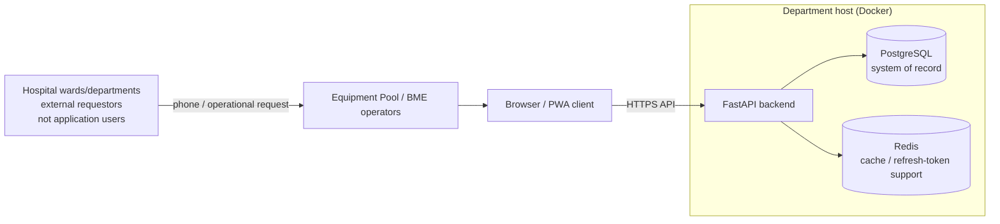
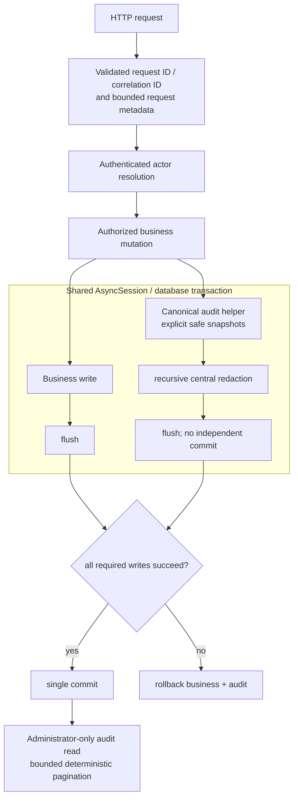
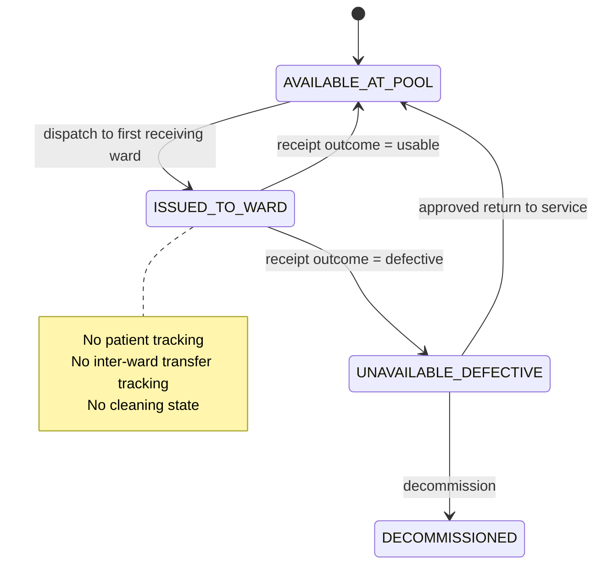

# Architecture Diagrams

These diagrams are navigation aids, not independent requirements. Text in
[`../ARCHITECTURE_DECISIONS.md`](../ARCHITECTURE_DECISIONS.md),
[`../HOSPITAL_DOMAIN_MODEL.md`](../HOSPITAL_DOMAIN_MODEL.md), and the assigned
Roadmap section remains authoritative.

## System context

> **Note (Owner decision, 2026-10-13):** Production runs on a department PC
> (Windows 11 Pro, Docker), not a managed cloud platform; see
> `docs/DECISION_LOG.md` ("Local Production on the department host") and
> Roadmap PR25A-E. The diagram below shows the application components, not a
> hosting provider. Google Drive backup upload (PR25A), Cloudflare Tunnel +
> Access (PR25C), and offline client operation (PR25D/E) are planned and not
> drawn because they are not built.

The application does not assume direct access to hospital-managed servers; it
runs on the department host. The older “Managed deployment preferred” text in
`ARCHITECTURE_DECISIONS.md` is superseded by the Owner decision above.

## Audit and transaction flow

Authentication-event persistence has its separately documented availability
strategy; unknown failed-login identifiers have null actor/subject and no
persisted identity representation. See
[`../adr/ADR-0001-canonical-audit-and-failed-login-identifiers.md`](../adr/ADR-0001-canonical-audit-and-failed-login-identifiers.md).

## Equipment Pool domain flow

Shift Sessions and Standby Snapshots are confirmed future concepts outside this
state machine. They are not inferred from transactions and are not introduced by
these diagrams.
